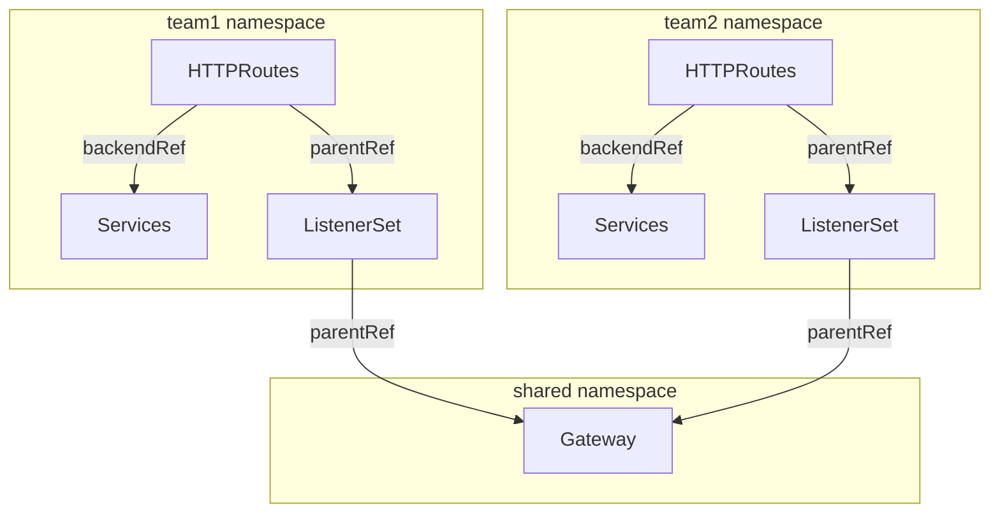

Set up listeners on your API Gateway. A listener configures how your API Gateway accepts and processes incoming requests.

In the Kubernetes Gateway API, you can create listeners in two main ways:

* Inline as part of the Gateway resource.
* As a separate resource called a ListenerSet.

## Inline on the Gateway {#inline}

A common, simple approach is to write the listener inline on the Gateway resource. You have the flexibility to write different protocols, ports, and even TLS certificates. Each listener can specify its own hostname, or inherit the hostname of the Gateway. Gateways support up to 64 listeners.

Most examples in both the  and Kubernetes Gateway API docs use the inline approach.

## ListenerSets {#listenersets}

With ListenerSets, you can group together listeners that have their own unique configuration, such as different protocols, ports, hostnames, or TLS settings. Then, the ListenerSet refers to a Gateway, which can be in a different namespace than the ListenerSet. The same Gateway can also have multiple ListenerSets.

Similar to Gateways, ListenerSets can have a maximum of 64 listeners. However, because you can attach multiple ListenerSets to a single Gateway, now a single Gateway can have more than 64 listeners. Keep in mind that more listeners can impact how long it takes to propagate configuration changes on the Gateway. If you have more than 1,000 listeners, consider attaching ListenerSets to multiple Gateways.

### ListenerSet use cases {#listenerset-use-cases}

As such, you might use ListenerSets for the following advantages:

- **Multitenancy**: You can let different teams create their own ListenerSets, but share the same Gateway and backing load balancing infrastructure.
- **Inheritance**: Because ListenerSets inherit routes and policies from the Gateway, you can standardize the configuration of listeners across a multitenant environment. Teams still have the flexibility to overwrite settings in the ListenerSet.
- **Large scale deployments**: By using ListenerSets, Gateways can have more than 64 listeners attached. Teams can also share the same ListenerSet configuration to avoid duplication.
- **Certificates for more listeners per gateway**: Because you can now have more than 64 listeners per Gateway, a single Gateway can forward secured traffic to more backends that might have their own certificates. This approach aligns with projects that might require service-level certificates, such as Istio Ambient Mesh or Knative.

The following diagram presents a simple illustration of how ListenerSets can help you decentralize route configuration in a multitenant environment at scale.

* Team 1 and Team 2 each manage their own Service and HTTPRoute resources within their respective namespaces.
* Each HTTPRoute refers to a namespace-local ListenerSet. This way, each team controls how their routes are exposed, such as the protocol, port, and TLS certificate settings.
* The ListenerSets from both teams share a common Gateway in a separate namespace. A separate Gateway team can setup and manage centralized infrastructure or enforce policies as appropriate.




### More information {#more-info}

The listener setup guides in this section include tabs for examples of using both the inline and ListenerSet approaches.

For more information about ListenerSets, see the [Kubernetes Gateway API docs](https://gateway-api.sigs.k8s.io/geps/gep-1713/).

## Route hostname precedence {#route-hostname-precedence}

Several HTTPRoutes or TLSRoutes can attach to the same listener and end up serving the same host. For example, a route for `*.example.com` and a route for `foo.example.com` both serve `foo.example.com` on a listener for `foo.example.com`. In that case, the route with the more specific hostname takes precedence. This rule is applied before HTTP match specificity, such as the path or headers.

Routes are ranked as follows, from most to least specific:

1. Exact hostnames, such as `foo.example.com`.
2. Wildcard hostnames, with longer wildcards ahead of shorter ones. For example, `*.foo.example.com` comes before `*.example.com`.
3. Routes without a hostname.

For TLSRoutes, only one route can own each SNI domain. If a TLSRoute loses every SNI domain to more specific routes, the route reports `kgateway.dev/Programmed=False` with reason `Conflicted`. If a TLSRoute owns some SNI domains and loses others, the route keeps serving the SNI domains that it owns. The `Conflicted` condition message names the routes with the lost domains.

### HTTPRoute example {#route-hostname-precedence-httproute}

Assume a Gateway that has an HTTP listener for `foo.example.com`.

```yaml
apiVersion: gateway.networking.k8s.io/v1
kind: Gateway
metadata:
  name: http
  namespace: 
spec:
  gatewayClassName: 
  listeners:
  - name: http
    protocol: HTTP
    port: 80
    hostname: foo.example.com
    allowedRoutes:
      namespaces:
        from: All
```

Two HTTPRoutes attach to the listener. Route A has a wildcard hostname and a specific path prefix. Route B has an exact hostname and a catch-all path prefix.

```yaml
apiVersion: gateway.networking.k8s.io/v1
kind: HTTPRoute
metadata:
  name: route-a
  namespace: default
spec:
  parentRefs:
  - name: http
    namespace: 
  hostnames:
  - "*.example.com"
  rules:
  - matches:
    - path:
        type: PathPrefix
        value: /api
    backendRefs:
    - name: api-service
      port: 8080
---
apiVersion: gateway.networking.k8s.io/v1
kind: HTTPRoute
metadata:
  name: route-b
  namespace: default
spec:
  parentRefs:
  - name: http
    namespace: 
  hostnames:
  - foo.example.com
  rules:
  - matches:
    - path:
        type: PathPrefix
        value: /
    backendRefs:
    - name: catch-all-service
      port: 8080
```

Both routes intersect with the gateway listener hostname `foo.example.com`, so a request to `foo.example.com/api/users` matches both routes. The gateway applies the following rules to choose a route:

1. Compare the hostnames of the routes. The route with the more specific hostname goes first.
2. Only if the hostnames are equally specific, compare the path, header, and other matches.

Route B has the more specific hostname, `foo.example.com`, so it is evaluated first. Its `/` path prefix matches the request, so the `catch-all-service` backend serves it. The `/api` rule of route A is never reached for this host.

To send `/api` requests to the `api-service` backend, give route A the same hostname as route B. Then, the longer path prefix takes precedence. 

### TLSRoute example {#route-hostname-precedence-tlsroute}

Assume a Gateway with a TLS passthrough listener for the `app.example.com` hostname.

```yaml
apiVersion: gateway.networking.k8s.io/v1
kind: Gateway
metadata:
  name: tls-passthrough
  namespace: 
spec:
  gatewayClassName: 
  listeners:
  - name: tls
    protocol: TLS
    port: 8443
    hostname: app.example.com
    tls:
      mode: Passthrough
    allowedRoutes:
      namespaces:
        from: All
```

Two TLSRoutes attach to the listener. The `wildcard` route is older and has a wildcard hostname. The `exact` route is newer and has an exact hostname.

```yaml
apiVersion: gateway.networking.k8s.io/v1
kind: TLSRoute
metadata:
  name: wildcard
  namespace: default
spec:
  parentRefs:
  - name: tls-passthrough
    namespace: 
  hostnames:
  - "*.example.com"
  rules:
  - backendRefs:
    - name: wildcard-service
      port: 443
---
apiVersion: gateway.networking.k8s.io/v1
kind: TLSRoute
metadata:
  name: exact
  namespace: default
spec:
  parentRefs:
  - name: tls-passthrough
    namespace: 
  hostnames:
  - app.example.com
  rules:
  - backendRefs:
    - name: exact-service
      port: 443
```

Both routes intersect with the gateway listener at the SNI domain `app.example.com`. The gateway proxy cannot have two filter chains for the same SNI domain, so only one route can own it. The gateway applies the following rules to choose the owner:

1. Compare the hostnames of the routes. The route with the more specific hostname owns the domain.
2. Only if the hostnames are equally specific, the oldest route owns the domain.

The `exact` route has the more specific hostname, `app.example.com`, so it owns the domain, even though the `wildcard` route is older. The `wildcard` route does not serve requests on the `app.example.com` domain. 

To check the status of the losing route, run the following command. In the output, look for the `Programmed` condition in the parent status.

```sh
kubectl get tlsroute wildcard -n default -o yaml
```
